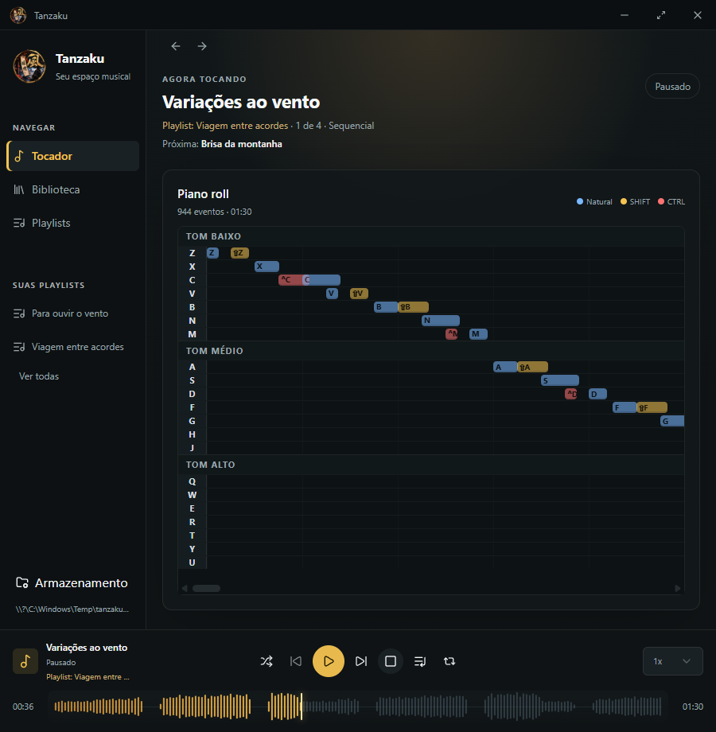
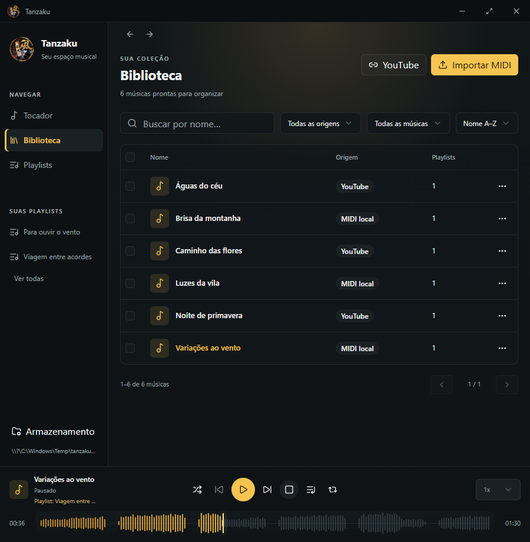
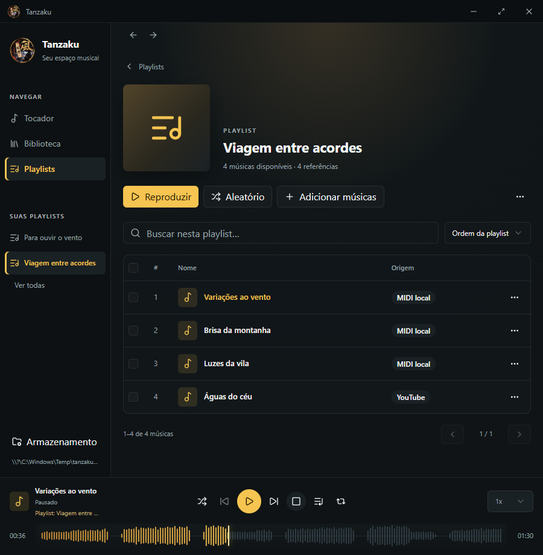

# Tanzaku


Seu espaço musical em **Where Winds Meet**. Importe MIDIs, organize sua biblioteca e toque no modo Música Livre com um piano roll que acompanha cada nota.

[Baixar para Windows](https://github.com/brunosb/tanzaku/releases/latest) · [Reportar um problema](https://github.com/brunosb/tanzaku/issues/new/choose) · [Contribuir](CONTRIBUTING.md)

Abra o jogo no modo Música Livre. Se o jogo exigir administrador, execute o Tanzaku com o mesmo nível de permissão para permitir o envio de notas.



*Os três grupos de teclas ficam visíveis na janela inicial. As capturas usam dados demonstrativos.*

## Funcionalidades

- Importação de MIDI e conversão de uma URL individual do YouTube.
- Busca sem distinção de acentos ou maiúsculas, filtros de origem e participação em playlists.
- Playlists com adição em lote e edição da ordem das músicas.
- Paginação de 20 itens, com seleção preservada entre páginas.
- Reprodução sequencial ou aleatória, velocidade ajustável e busca pela forma de onda.
- Avanço automático opcional, com escolha salva por biblioteca.



*Busca e organização da coleção, independentes da reprodução.*



*Cada playlist tem busca, paginação e ordem persistida.*

## Instalar e tocar

1. Baixe `Tanzaku_<versão>_x64-setup.exe` na [última release](https://github.com/brunosb/tanzaku/releases/latest).
2. Execute o instalador no Windows 10/11 x64. Se o WebView2 ainda não estiver instalado, será necessário acesso à internet para instalá-lo.
3. Inicie o Tanzaku e importe um MIDI pela biblioteca.
4. Abra a música e clique em Reproduzir. Durante a contagem de cinco segundos, foque a janela do jogo.

O instalador inclui yt-dlp standalone, QuickJS-NG, FFmpeg de áudio, Basic Pitch ONNX e ONNX Runtime com suas DLLs locais do Visual C++. Não é necessário instalar Node.js, Rust, Python, uv ou FFmpeg. A conversão do YouTube requer internet; o yt-dlp pode receber atualizações oficiais verificadas automaticamente, sem substituir a versão incluída no aplicativo.

Para conferir o download, compare o resultado abaixo com `SHA256SUMS.txt` da release:

```powershell
Get-FileHash .\Tanzaku_1.0.0_x64-setup.exe -Algorithm SHA256
```

| Controle | Comportamento |
| --- | --- |
| Reproduzir / Pausar | Inicia com contagem de cinco segundos ou pausa a faixa |
| Tocar em segundo plano | Envia as notas à janela capturada do jogo após a contagem; pode ser alterado quando a faixa está pausada |
| Ctrl+Alt+Home / Ctrl+Alt+End | No segundo plano, pausa / para e cancela transições pendentes |
| Home / End | No modo que exige foco, pausa / para e cancela transições pendentes |
| Anterior / Próxima | Navega pela fila, mesmo com avanço automático desligado |
| Avanço automático | Desligado inicialmente; quando ligado, continua pela fila |
| Repetir | Repete a faixa atual com avanço desligado, ou a fila com avanço ligado |
| Aleatório | Percorre as faixas sem repetir na rodada e preserva o histórico |
| Forma de onda | Permite buscar por clique, arraste ou teclado |

O modo em segundo plano fica ativo por padrão e usa a janela focada no final da contagem inicial, mesmo quando você alterna para outros programas. Fechar ou minimizar o jogo pausa a faixa e libera as teclas. Desative o modo para usar o comportamento anterior, que pausa quando o jogo perde o foco. Trocas manuais durante a reprodução usam uma nova contagem; a continuação automática preserva a janela do jogo e dispensa outra contagem.

A fila da biblioteca usa todo o resultado filtrado e ordenado, incluindo outras páginas. Na playlist, usa a ordem salva completa. Edições posteriores valem para a próxima abertura. A fila e o modo aleatório duram a sessão.

O mapa musical trabalha com as alturas MIDI 48–83, usando teclas naturais, SHIFT e CTRL. Notas fora da faixa e limitações de acordes são contabilizadas no plano. A transcrição automática pode precisar de revisão musical.

## Desenvolver

Interface em React, TypeScript, Vite, Tailwind CSS e shadcn/ui; backend em Rust/Tauri, responsável pelo relógio musical e envio de teclas.

Requisitos: Windows x64, Git LFS, Node.js 22.12+, npm, Rust via rustup, ferramentas C++ do Visual Studio e WebView2. O Rust é fixado em `rust-toolchain.toml`.

```powershell
git clone https://github.com/brunosb/tanzaku.git
cd tanzaku
git lfs install
git lfs pull
npm ci
npm run tauri:run
```

**Para testar a reprodução no jogo em desenvolvimento, execute o terminal como administrador.** O FFmpeg deve ser recuperado como binário completo pelo Git LFS; o build rejeita ponteiros LFS.

| Comando | Finalidade |
| --- | --- |
| `npm start` | Compilar a interface e executar o aplicativo |
| `npm test` | Estilo, arquitetura, versões, TypeScript, interface e Rust |
| `npm run test:desktop` | Smoke no WebView2 real, IPC e ONNX, sem enviar teclas |
| `npm run tauri:build` | Gerar NSIS com recursos e avisos de licença |
| `npm run test:installer` | Instalar em pasta de teste e validar o app empacotado |
| `npm run check:version` | Conferir versões dos manifestos e lockfiles |

O instalador fica em `src-tauri/target/release/bundle/nsis`. Testes desktop usam dados temporários isolados. Medições de apresentação e testes com o jogo são validações distintas.

| Diretório | Responsabilidade |
| --- | --- |
| `src/app` | Composição, navegação e layout |
| `src/features` | Catálogo, reprodução e configurações |
| `src/shared` | Contratos IPC, componentes e estilos |
| `src-tauri/src` | Biblioteca, MIDI, transporte e transcrição |
| `test` / `tools` | Regressões, fixtures, build e smoke |
| `specs` | Arquitetura e critérios de aceitação |

Em instalações novas, os dados ficam em `%LOCALAPPDATA%\Tanzaku`, junto à instalação por usuário, ou na pasta escolhida em Armazenamento. Escolhas e dados de instalações anteriores continuam compatíveis. `TANZAKU_DATA_DIR` isola os dados de desenvolvimento. Excluir da biblioteca remove o MIDI e seus vínculos após confirmação; remover de uma playlist preserva o arquivo.

Uma conversão do YouTube executa por vez. Para diagnóstico, `TANZAKU_FFMPEG`, `TANZAKU_YTDLP` e `TANZAKU_BASIC_PITCH_MODEL` aceitam caminhos alternativos. As fixtures automatizadas não exigem Python; sua regeneração é uma tarefa separada.

## Contribuir e publicar

Abra uma issue ou envie uma PR a partir de um fork. A `main` exige PR e CI aprovado; o proprietário faz os merges. Use Conventional Commits: `fix:` para correções, `feat:` para funcionalidades e `!` ou `BREAKING CHANGE` para incompatibilidades.

O Release Please prepara uma PR de versão com changelog e manifestos sincronizados. Após seu merge, o CI gera e testa o instalador e publica a release com checksum. Consulte [CONTRIBUTING.md](CONTRIBUTING.md), o [guia de releases](docs/releases.md) e as [regras de arquitetura](specs/12-project-organization.md).

## Licença

O código do Tanzaku está sob [ISC](LICENSE). Componentes distribuídos mantêm suas próprias licenças, incluindo FFmpeg sob LGPL e o executável do yt-dlp sob GPLv3+. Textos, atribuições e referências de código fonte acompanham o instalador em `licenses`; veja os [avisos de terceiros](src-tauri/licenses/README.txt).

Tanzaku é um projeto da comunidade, sem vínculo oficial com Where Winds Meet.
